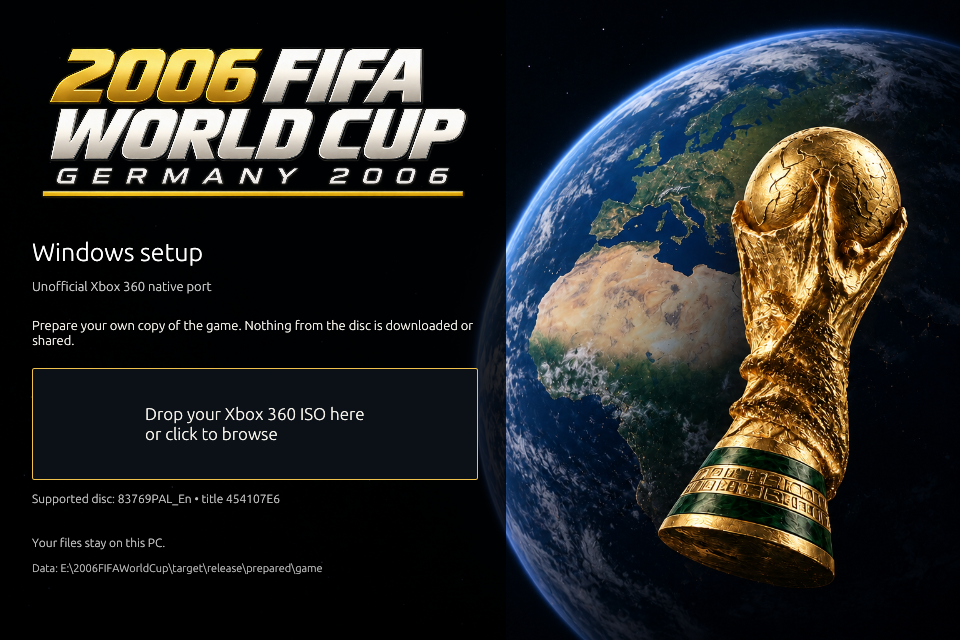
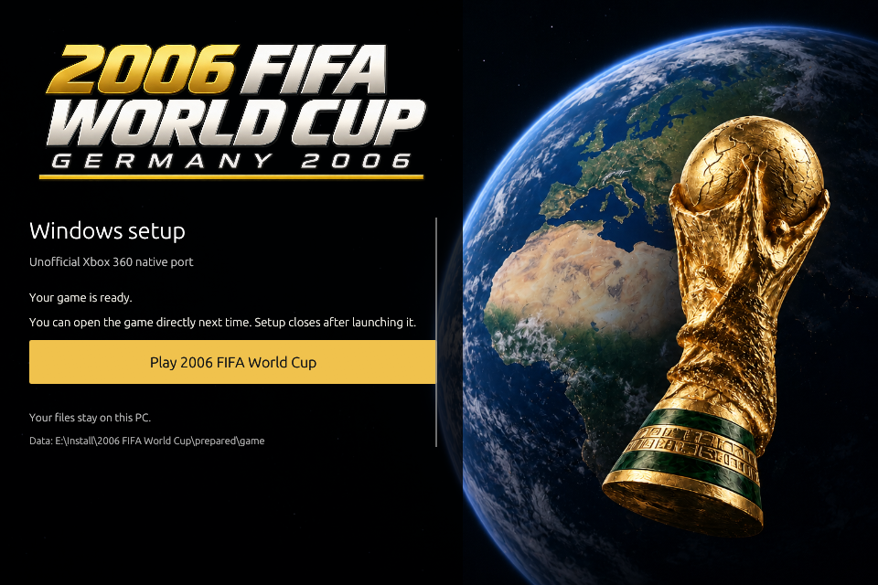

# 2006 FIFA World Cup

An unofficial Windows port of the **Xbox 360 version**, built with
[ReXGlue](https://github.com/rexglue/rexglue-sdk). Bring your own supported disc
image. Setup extracts it and builds the game on your PC.

[Download the Windows setup](https://github.com/iptory/fifa-world-cup-2006-native/releases/latest)



## Install

Download the setup ZIP from Releases and extract the whole archive to a writable
folder. Open `fifa-importer.exe`, then drop your ISO onto the window or click to
browse. Setup checks the revision before copying any game files. If valid prepared
data is already there, it reuses it.

The setup and builder are precompiled Rust programs. The game executable is built
locally, so the first build still needs **Git**, **LLVM/Clang 20 or newer**, and
**Visual Studio with Desktop development with C++**. CMake and Ninja can come from
Visual Studio. Install these from their official publishers before starting the
build. Rust is not required to use the downloaded setup. The first runtime build
also needs internet access.

During compilation, the window shows build output and writes `build.log` beside
setup. If a build fails, read that log, fix the reported missing tool or error,
and use **Check prepared files again** to retry without extracting the disc again.

When setup finishes, choose **Play 2006 FIFA World Cup**. After that, you can open
`fifa_world_cup_2006.exe` directly; setup doesn't need to stay open. Keep the DLLs
and `prepared/` folder beside the game. `project/` is used for building and
rebuilding, not while playing. Back up your saves before moving an installation.



## Supported copy and requirements

This build accepts Xbox 360 revision `83769PAL_En`, title ID `454107E6`, media ID
`4C1B827B`, version `0.0.0.8`. Other revisions are rejected. It reads the supported
raw XDVDFS disc layout, not every Xbox image or archive format.

The SHA-256 of the supported `default.xex` is:

```text
cb184f76112c3e60ec658cc1398779c3b9e09f3007f4ec2b6482bd22b66929b6
```

Windows x86-64, an x86-64-v2 CPU and a D3D12-capable GPU/driver are required.
The game window takes its original title and icon from the locally loaded game
metadata. The setup artwork is separate.

The Windows baseline previously completed a friendly match and restored earned
points and a saved setting after restart. Full mode coverage, broad hardware
compatibility, uncapped rendering and timing at higher frame rates remain
unverified. This setup release does not turn those checks into completed work.

## Build from source

Install Rust stable as well as the Windows tools above. From the repository root:

```text
cargo build --release --workspace --locked
target\release\fifa-importer.exe --import "path\to\your.iso" --destination private\game
cargo run --release -p xtask --locked -- --install .work\player
```

The native build uses a private working tree under `.work/native-project` and writes binaries to
`.work/build-windows-game`. Game files, generated code, build caches and saves do
not belong in Git.

To create the setup-only release archive:

```text
cargo run --release -p xtask --locked -- --release-setup
```

The packager builds the Rust utilities, includes the project inputs and dependency
licenses, and rejects game executables, disc images and generated game output.
The SDK is pinned to ReXGlue v0.10.0, commit
`f5337cdc947ff6d4c4196737e2c807a48f2a1fc2`. The metadata helper is Rust; Python
package discovery is disabled in the runtime build.

Source checks do not need an ISO or launch the game:

```text
cargo fmt --all -- --check
cargo clippy --workspace --all-targets --locked -- -D warnings
cargo test --workspace --locked
```

## Licensing and distribution

[MIT](LICENSE) covers project-authored source. Dependencies retain their own terms;
the setup ZIP includes their Windows license texts in `THIRD_PARTY_LICENSES.txt`
and the Rust standard-library notices in `RUST-STANDARD-LIBRARY.html`.
Native patch provenance is recorded in [native/licenses](native/licenses/).
The repository owner supplied the setup artwork and stated they created it;
[artwork provenance](crates/importer/assets/README.md) records that separately.

Releases contain setup/build utilities and project source, **not** the game
executable, generated game code, original binaries or extracted assets. Those
remain local. Do not upload your ISO, prepared data, or locally compiled game.
The locally built runtime is based in part on the work of the Independent JPEG
Group.

This project is not affiliated with or endorsed by Electronic Arts, FIFA,
Microsoft or the runtime authors. Names, logos and other marks remain their
owners'. Owning a disc does not settle copyright, trademark or anti-circumvention
questions in every jurisdiction, and no disclaimer prevents a takedown. See
[GitHub's DMCA policy](https://docs.github.com/en/site-policy/content-removal-policies/dmca-takedown-policy)
and [trademark policy](https://docs.github.com/en/site-policy/content-removal-policies/github-trademark-policy).
Get qualified legal advice before relying on any claim of legal protection.
